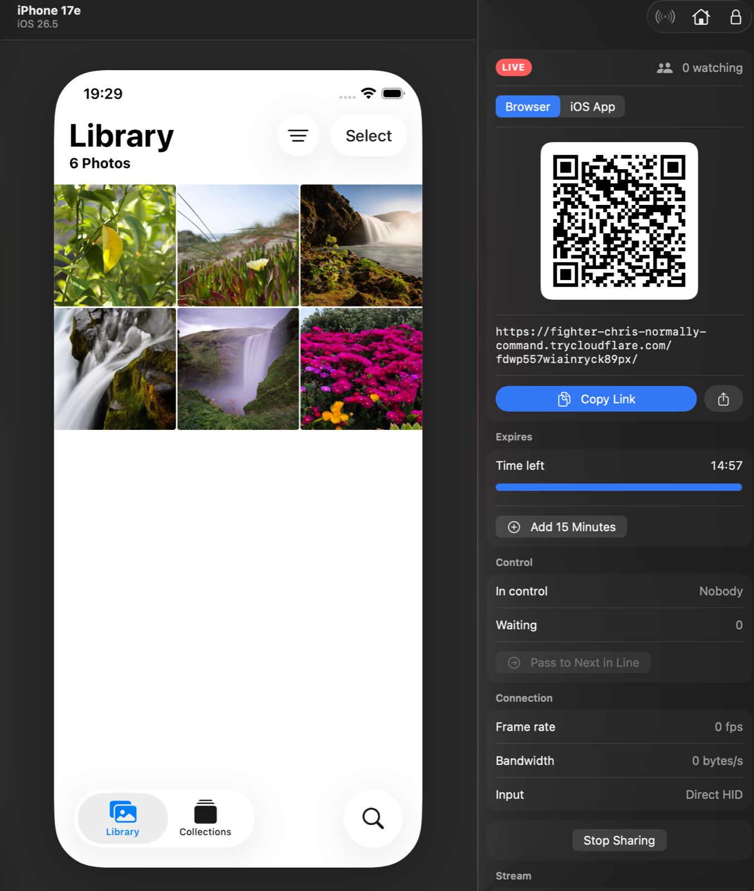
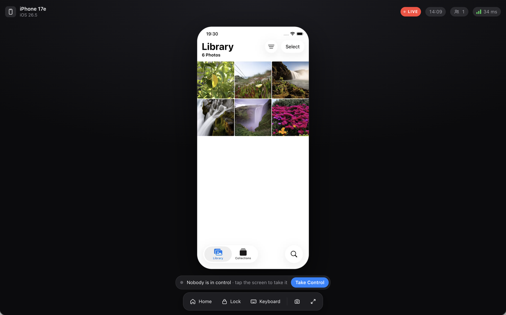
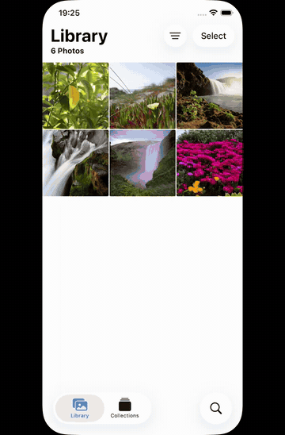

# SimStream

Share a running iOS simulator at a public link. Viewers watch a low-latency H.264 stream in the browser or the native iOS viewer, and can take turns controlling it.



- **Mac app** (`mac/`): pick a simulator, share it, get a link and a QR code. Shares can also run on another Mac over SSH, so the link outlives your laptop's lid.
- **CLI** (`simstream`): the same engine, headless, for Macs you reach over SSH.
- **iOS viewer** (`ios/`): scan the QR code and use the simulator with real multi-touch.

<table>
<tr>
<td width="62%"></td>
<td></td>
</tr>
<tr>
<td>Anyone with the link opens it in a browser.</td>
<td>The iOS viewer, with real multi-touch (<a href="docs/media/ios-viewer.mp4">MP4</a>).</td>
</tr>
</table>

Read [SECURITY.md](SECURITY.md) before sharing with control on. A link is full access to that simulator, and the simulator can reach your Mac's network.

## Requirements

- macOS 26 with Xcode 26 and an iOS 26 simulator runtime
- [XcodeGen](https://github.com/yonaskolb/XcodeGen), [AXe](https://github.com/cameroncooke/AXe) and [cloudflared](https://github.com/cloudflare/cloudflared): `brew install xcodegen cameroncooke/axe/axe cloudflared`
- Optional, for Android: the Android SDK (Android Studio, or `brew install --cask android-commandlinetools`) and [scrcpy](https://github.com/Genymobile/scrcpy) (`brew install scrcpy`). Emulators and devices with USB or wireless debugging on show up next to the simulators.

## Install

```sh
mac/scripts/install.sh
```

This vendors AXe's frameworks, builds both targets and installs `~/Applications/SimStream.app` plus `~/.local/share/simstream` with a `simstream` symlink in `~/.local/bin`. Re-run it after `brew upgrade axe` or an Xcode update.

## CLI

```sh
simstream list
simstream start --name "iPhone 17" --minutes 15   # prints the link once it's live
simstream apps --udid <udid>                      # apps you can keep viewers in
simstream ctl lock com.example.app                # or start with --lock-app com.example.app
simstream ctl control off
simstream stop
```

`simstream share` runs in the foreground; `--no-tunnel` serves on 127.0.0.1 only. Android emulators are `avd:<name>` in `simstream list`. Sharing a real phone needs `--allow-physical`: a link to it reaches every app and account on that phone.

## iOS viewer

```sh
cp ios/Config/Local.xcconfig.example ios/Config/Local.xcconfig   # your team ID and bundle ID prefix
cd ios && xcodegen generate && open SimStreamViewer.xcodeproj
```

## How it works

SimStream links the FBSimulatorControl frameworks that ship with AXe. Input goes over a persistent HID connection (about 1 ms per event). Frames come from the simulator's framebuffer IOSurface, get encoded with VideoToolbox, and are decoded with WebCodecs in the browser or `AVSampleBufferDisplayLayer` on iOS, with JPEG as the fallback. The server binds to 127.0.0.1, and a Cloudflare quick tunnel makes it public.

Android devices go through [scrcpy](https://github.com/Genymobile/scrcpy)'s server over `adb forward`: the device encodes H.264, VideoToolbox decodes it into an IOSurface, and from there it streams exactly like a simulator. Input travels over scrcpy's control socket as real Android pointers and key events. The server must match the installed scrcpy version, which SimStream reads from the Homebrew install.

The wire format is defined in three places that must change together: `mac/SimStream/Server/ViewerProtocol.swift`, `mac/SimStream/Resources/viewer.html` and `ios/SimStreamViewer/Model/ViewerProtocol.swift`.

## License

MIT. See [THIRD_PARTY_NOTICES.md](THIRD_PARTY_NOTICES.md) for what the build pulls in.
